# Star Tracker Report

**2026-10-18** | Total: **408 stars** | Change: **0**

> Compared to snapshot from 2026-10-17

## 📈 Star Trend

### By Repository

Individual Repository Charts

#### nasty-project/nasty: 408 ★ (0)

## Repositories

| Repositories | Stars | Change | Trend |
|:-----------|------:|-------:|:-----:|
| [nasty-project/nasty](https://github.com/nasty-project/nasty) | 408 | 0 | ➖ |

## Summary

- **Stars gained:** 0
- **Stars lost:** 0
- **Net change:** 0

## 🔮 Growth Forecast

**Aggregate Forecast**

| Method | Week 1 | Week 2 | Week 3 | Week 4 |
|:---|---:|---:|---:|---:|
| Linear Regression | 422 | 436 | 450 | 463 |
| Weighted Moving Average | 419 | 430 | 441 | 452 |

### By Repository

nasty-project/nasty

**nasty-project/nasty**

| Method | Week 1 | Week 2 | Week 3 | Week 4 |
|:---|---:|---:|---:|---:|
| Linear Regression | 422 | 436 | 450 | 463 |
| Weighted Moving Average | 419 | 430 | 441 | 452 |

---
*Generated by [GitHub Star Tracker](https://github.com/fbuireu/github-star-tracker) on 2026-10-18T02:49:48.447Z*

*Made with 🤘 by [Ferran Buireu](https://github.com/fbuireu)*

